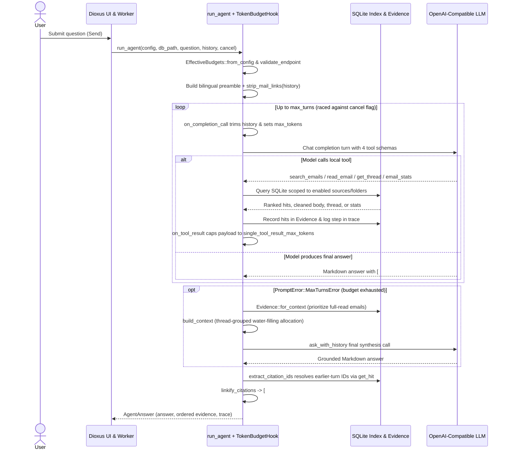

# Architecture and release gates

`MailSource -> normalized Email (body_text + EN/FR Snowball stems) -> SQLite messages + FTS5/BM25 -> Tool-calling Rig agent (search_emails, read_email, get_thread, email_stats) -> private LLM -> [#id](mail://id) citations & ordered evidence`

## UI Layer (`Dioxus 0.7 Desktop` + `src/components/`)

The desktop interface is organized as a 3-pane workspace rendered via Dioxus 0.7 Desktop and styled primitives from `src/components/` (`dioxus-primitives` + `dioxus-icons` with CSS modules and theme variables in `assets/dx-components-theme.css` / `src/app/theme.rs`):

- **Left Sidebar (`src/app/sidebar.rs`)**: Structured with `SidebarHeader`, `SidebarContent`, `SidebarGroup`, `SidebarGroupContent`, `SidebarMenu`, `SidebarMenuItem`, `SidebarMenuBadge`, `SidebarMenuSub`, and `SidebarMenuSubItem` inside a `ScrollArea`. Collapsible sections (`Mailboxes`, `Labels`, and `Settings` — collapsed by default and grouping `LLM Judge and RAG`, `Laya Decision Model`, and `Storage`) use `Collapsible`, `CollapsibleTrigger`, and `CollapsibleContent`. Form controls and filters use `ToggleGroup` / `ToggleItem`, `Checkbox`, `Switch`, `Input`, `Label`, `Badge`, and `Separator`, including endpoint, model, bearer token, and `max_context_tokens` controls.
- **Center Explorer & Reading Pane (`src/app/explorer.rs`)**: Uses `Toolbar`, `ToolbarGroup`, `ToolbarSeparator`, `ToggleGroup`, `Input`, and `Button` for quick-filtering and batch/focused labeling controls. The message table loads lightweight summaries (`Index::list_message_summaries`, bounded by `explorer_message_limit`), fetches the selected message body on demand (`Index::get_message`), and reuses `CachedExplorerRow` / `CachedReaderView` caches across re-renders. The table and reading pane use `Checkbox`, `Avatar` / `AvatarFallback`, `Badge`, `Separator`, and `ScrollArea` separated by draggable horizontal splitters.
- **Right RAG Chat Pane (`src/app/chat.rs`, `src/app/markdown.rs`)**: Uses `ScrollArea`, `Avatar` / `AvatarFallback`, `Input`, `Checkbox`, `Label`, `Separator`, and `Collapsible` + `ItemGroup` (`Item`, `ItemHeader`, `ItemMedia`, `ItemContent`, `ItemTitle`, `ItemDescription`, `ItemActions`) for cited email evidence cards, inline `[#id](mail://id)` citation links that open the referenced message in the reading pane, and expandable tool-call trace inspection.

## Retrieval, Storage, Tool-Calling Agent & Context Engineering

### 1. Local FTS5/BM25 Index & Structured Query Engine (`src/db.rs`, `src/db/query.rs`, `src/text.rs`)

BM25 retrieval runs entirely in the bundled SQLite index (`messages_fts` using `unicode61 remove_diacritics 2`). At indexing time (`src/text.rs`):
- `text::index_body` strips HTML markup, quoted reply chains, and signatures to store clean message text in `body_text`.
- `text::index_stems` computes English and French Snowball stems into the `stems` column so morphological variants match reliably.

Queries (`query::parse_query`) support free-text keywords, `"exact phrases"`, prefix matching (`term*`), and structured filters (`from`, `to`, `date_from`/`after`, `date_to`/`before`, `folder`, `label`, `has_attachment`, along with French aliases). Search (`Index::search_emails`) expands terms with their Snowball stems, executes strict `AND` matching first with an `OR` fallback when fewer than `limit` distinct threads match, and collapses results to the highest-ranking hit per conversation thread (annotating `thread_matches` when multiple messages in a thread match).

*(Note: Remote embedding storage and reciprocal-rank hybrid search in `src/db/search.rs` and `src/llm.rs` are preserved in the codebase behind `llm::EMBEDDINGS_ENABLED = false`, keeping runtime retrieval 100% local BM25.)*

Indexed sources are tracked by their archive path. Archive and folder enablement are non-destructive query filters applied consistently across all search, thread, stats, and lookup queries. Removing a source deletes only its indexed messages; SQLite cascades the deletion to their vectors/labels and the FTS delete trigger removes their terms. The source PST remains read-only and untouched.

### 2. Tool-Calling Research Agent (`src/llm/agent.rs`)

When the user asks a question (`llm::run_agent`), a Rig agent is constructed with four `PortableTool` implementations sharing an `Arc<Shared>` state (holding the SQLite `Index`, an `Evidence` accumulator, a numbered tool-call trace log, and a UI `ProgressFn`):

- **`search_emails` (`SearchEmailsTool`)**: Runs BM25 keyword + filter searches and returns one result per thread with metadata headers, `thread_matches` hints, and a snippet (`text::best_passages`, scaled from `snippet_chars`). Marks hits as seen (`read = false`) in `Evidence`.
- **`read_email` (`ReadEmailTool`)**: Fetches a single email by ID (`Index::get_hit`), cleans its body via `clean_email_body`, and truncates to the effective `read_email_max_chars` budget. Marks the hit as `read = true`.
- **`get_thread` (`GetThreadTool`)**: Fetches chronological conversation messages by `thread_id` or `email_id` (`Index::get_thread`, keeping the root message and most recent tail for long threads) with quoted replies removed and bodies scaled within the effective `thread_total_chars` budget. Marks all returned messages as `read = true`.
- **`email_stats` (`EmailStatsTool`)**: Counts messages matching strict `AND` keywords and filters (`Index::email_stats`), optionally grouped by `sender`, `month`, `year`, `folder`, or `label` (capped by the effective group limit) so the model never has to count search results manually.

### 3. Adaptive Token Budgeting, Context Engineering & Citation Grounding (`src/llm/budget.rs`, `src/llm/context.rs`, `src/llm/agent.rs`)

- **Adaptive context window scaling (`EffectiveBudgets::from_config`)**: When `max_context_tokens` is non-zero (minimum clamped to `512`; `0` disables token scaling), `EffectiveBudgets` reserves output tokens and downscales prompt density (`Full`, `Compact`, `UltraCompact` — shrinking both system prompts and tool JSON schemas), result limits, snippet/body/thread character budgets, conversation history length, and LLM Judge rubric/excerpt sizes so requests fit even very small LLM context windows (e.g., 1,024–4,096 tokens).
- **Live Rig `AgentHook` (`TokenBudgetHook`)**: Before each model completion turn (`on_completion_call`), `trim_rig_history_for_completion` evicts older conversation turns, compacts earlier `ToolResult` messages, or drops oldest `(ToolCall, ToolResult)` pairs while preserving valid tool-call pairing and the active question, and dynamically sets per-request `max_tokens`. `on_tool_result` caps oversized individual tool payloads.
- **Bilingual system prompts (`agent_system_prompt_for_density`, `rag_system_prompt`)**: Instructs the agent to search before answering, separate people/dates/folders/labels into structured filters, read full emails or threads rather than trusting snippets, reason over chronological timelines and superseded decisions, and cite claims strictly as `[#id]`. Today's local date and configured archive labels are appended dynamically.
- **Multi-turn conversation history**: Up to the effective `history_turns` completed user/assistant exchanges are passed to Rig (`to_rig_history`). Prior assistant messages pass through `strip_mail_links` so `[#123](mail://123)` UI links are presented to the model as canonical `[#123]` citations.
- **Email body cleaning (`clean_email_body`)**: Strips HTML, truncates English and French legal confidentiality disclaimers (`[Legal disclaimer omitted]`), omits deep nested quotes (`> > >`), condenses extended quote chains (> 6 lines), and normalizes horizontal dividers and blank lines.
- **Budget-exhaustion fallback (`build_context` + `ask_with_history`)**: The tool loop is capped at the effective `max_turns` budget and races against a cancellation `AtomicBool`. If the model hits `PromptError::MaxTurnsError`, the agent falls back to assembling collected evidence (`Evidence::for_context`, prioritizing emails read in full) via `build_context` — which groups messages by thread chronologically and uses water-filling budget allocation across items so a long email cannot starve others — and performs a final token-budgeted synthesis call via `ask_with_history`.
- **Citation verification & linkification (`extract_citation_ids`, `linkify_citations`)**: Cited IDs from earlier turns are resolved from the database if needed. `linkify_citations` converts verified `[#123]` / `[Email #123]` references into clickable `[#123](mail://123)` links and strips brackets from unknown IDs (`#999`). `Evidence::ordered` orders UI evidence cards with cited emails first (in citation order), followed by other emails read in full.

Rig targets the configured OpenAI-compatible chat-completions endpoint; `validate_endpoint` enforces HTTPS (with an exact `http://127.0.0.1` loopback exception for local inference servers) before constructing the HTTP client.

The `MailSource` boundary (`pst::import_streaming`) keeps parser-specific identifiers and lifetimes out of storage, retrieval, and UI code. Index writes are batched (500 messages per SQLite transaction) and `INSERT OR IGNORE` on a SHA-256 content hash makes repeated imports idempotent.

## Gates before production

1. Persist PST file identity, size, modification time, and stable node identifiers for fast incremental resume without re-scanning unchanged folders.
2. Test Unicode and ANSI PSTs, damaged archives, password-protected archives, large files, nested folders, RTF/HTML bodies, duplicated messages, and Outlook-held files against a representative corpus.
3. Sign the executable and generate an SBOM/license inventory. Confirm every dependency can be statically distributed.
4. Add OS credential store integration (e.g. Windows Credential Manager) for API secrets and a settings screen for private-root CA certificates. Never disable certificate validation.
5. Add explicit index deletion, disk-space checks, and crash-safe checkpointing.
6. Measure working set and index throughput on the lowest supported office PC.
7. Build and smoke-test the exact single executable on a clean Windows 11 VM with no developer runtime or Internet access.

## Locked PST files

Open read-only with permissive Windows share flags first. If a consistent read cannot be obtained, present an explicit local-snapshot action. VSS availability and authorization vary by organization and must be proven in the target environment; never modify the source PST and never pretend a normal byte copy is transactionally consistent while Outlook is writing.
